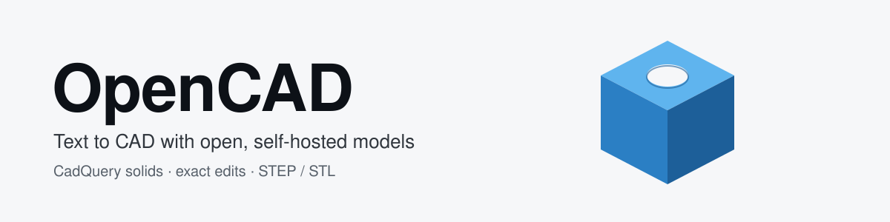

<div align="center">
  <picture>
    <source media="(prefers-color-scheme: dark)" srcset="./public/opencad-banner-dark.svg">
    <source media="(prefers-color-scheme: light)" srcset="./public/opencad-banner-light.svg">
    
  </picture>
</div>

<h1 align="center"> ⛮ OpenCAD ⛮ </h1>

<div align="center">

[](https://www.gnu.org/licenses/gpl-3.0)
[](https://nodejs.org/)
[](https://reactjs.org/)
[](https://supabase.com/)
[](https://openscad.org/)

</div>

---

## ✨ Features

- 🤖 **AI-Powered Generation** - Transform natural language and images into 3D models
- 🎛️ **Parametric Controls** - Interactive sliders for instant dimension adjustments
- 📦 **Multiple Export Formats** - Export as .STL, .SCAD, or .DXF files
- 🌐 **Browser-Based** - Runs entirely in your browser using WebAssembly
- 📚 **Library Support** - Includes BOSL, BOSL2, and MCAD libraries

## 🎯 Key Capabilities

| Feature                    | Description                                          |
| -------------------------- | ---------------------------------------------------- |
| **Natural Language Input** | Describe your 3D model in plain English              |
| **Image References**       | Upload images to guide model generation              |
| **Real-time Preview**      | See your model update instantly with Three.js        |
| **Parameter Extraction**   | Automatically identifies adjustable dimensions       |
| **Smart Updates**          | Efficient parameter changes without AI re-generation |
| **Custom Fonts**           | Built-in Geist font support for text in models       |

## 🔓 This fork: open, self-hosted models

OpenCAD is a fork of [CADAM](https://github.com/Adam-CAD/CADAM). It runs on **open models you host** and builds real solids (STEP/STL) with CadQuery/OpenCascade. No hosted-model API key is needed.

### Services

| Service | Purpose | Needed for |
| --- | --- | --- |
| `cad-plaintext` (llama-swap, `/v1/completions`) | Text to CAD sequence, and text edits of a sequence | Creating parts from a description |
| `cad-render` | Builds geometry and applies exact operations | Everything (it is not an AI model) |
| `cad-planner` | Request + selection → operations (cut, hole, fillet, chamfer, pocket, boss, fill, pattern, shell, ...) | Editing imported or selected geometry in plain English |
| CAD-Coder | Image to CadQuery | Image input only |
| CADFusion / CAD-Editor | Text to sequence / edit a sequence | Optional; used when `CAD_LLM_URL` is not set |

Deploy and operate them from [`model-services/DEPLOY.md`](model-services/DEPLOY.md). With llama-swap you can let it manage `cad-render` and `cad-planner` too and point the app at its `/upstream/<model>` routes (see below), so no SSH tunnel is needed.

### Choosing the model

The editor has a **Model** dropdown above the attach-image button:

- **cad-plaintext (self-hosted)**: the default. It is a completion model with no chat template. The app uses the CADFusion-style prompt for generation and `Task: CAD editing …` for edits, and checks every edit by rendering it before saving.
- **Claude Code (local CLI)**: runs `claude -p` with all tools disabled and returns CadQuery, which `cad-render` builds. It is for when the self-hosted model is down or not good enough for a request. It is available only when `ENVIRONMENT="local"`, because it spends your own Claude Code usage. Edits of a command-sequence model are rebuilt from scratch in CadQuery, so earlier exact operations are dropped; operations on CadQuery source are kept.

### Sketch profiles for pockets and bosses

`rect`, `circle`, `slot`, `polygon` (any 3-64 sides; `width` is across the flats, so hexagon is `sides: 6`), `ellipse`, `rounded_rect` and `star`. The planner picks the shape from your wording; the side count must be one the request names.

### Known limits

- `cad-plaintext` is a research model. Expect some edits to be rejected as not forming a valid solid; the app shows the reason and keeps your last good version.
- The planner is an 8B model behind strict validation. It never invents coordinates or numbers, so an unfamiliar phrasing returns "clarify" instead of a wrong answer. Rephrase, or name faces and edges and give each distance.

## 🚀 Quick Start

```bash
# Clone the repository
git clone https://github.com/0xrushi/opencad.git OpenCAD
cd OpenCAD

# Install dependencies
npm install

# Start Supabase
npx supabase start
npx supabase functions serve --no-verify-jwt

# Start the development server
npm run dev
```

## 📋 Prerequisites

- Node.js ^20.19.0 or >=22.12.0, with npm 10+
- Supabase CLI
- ngrok (for local webhook development)

## 🔧 Setting Up Environment Variables

### 1. Frontend Environment:

- Copy `.env.local.template` to `.env.local`
- Update all required keys in `.env.local`:
  ```
  VITE_SUPABASE_ANON_KEY="<Test Anon Key>"
  VITE_SUPABASE_URL='http://127.0.0.1:54321'
  ```

### 2. Server Environment:

- Add server-side keys to `.env.local`, including:
  ```
  CAD_FUSION_URL="http://127.0.0.1:18082"
  CAD_EDITOR_URL="http://127.0.0.1:18083"
  CAD_CODER_URL="http://127.0.0.1:18081"
  CAD_RENDER_URL="http://127.0.0.1:18084"
  CAD_PLANNER_URL="http://127.0.0.1:18085"
  # Optional: an OpenAI-compatible server (llama-swap) hosting cad-plaintext.
  # When set, text prompts and sequence edits use it instead of CADFusion / CAD-Editor.
  CAD_LLM_URL="http://<llama-swap-host>:8888"
  CAD_LLM_MODEL="cad-plaintext"
  # CAD_LLM_API_KEY=""
  # Optional: Claude Code as the alternative model (ENVIRONMENT must be "local").
  # CLAUDE_CODE_BIN="claude"
  # CLAUDE_CODE_MODEL=""
  # If llama-swap manages cad-render and cad-planner, use its upstream routes instead
  # of an SSH tunnel:
  # CAD_RENDER_URL="http://<llama-swap-host>:8888/upstream/cad-render"
  # CAD_PLANNER_URL="http://<llama-swap-host>:8888/upstream/cad-planner"
  SUPABASE_SERVICE_ROLE_KEY="<Test Service Role Key>"
  BILLING_SERVICE_URL="<Test Billing Service URL>"
  BILLING_SERVICE_KEY="<Test Billing Service Key>"
  ENVIRONMENT="local"
  ADAM_URL="<Adam URL or dev URL>" # Checkout and portal redirect target
  WEBHOOK_BASE_URL="<Public TanStack App URL>" # Your app URL for API callbacks
  NGROK_URL="<NGROK URL>" # Optional local Supabase Storage tunnel for provider-readable signed URLs
  ```

## 🌐 Setting Up ngrok for Local Development

OpenCAD uses public URLs for provider callbacks and local signed storage URLs:

1. Install ngrok if you haven't already:

   ```bash
   npm install -g ngrok
   # or
   brew install ngrok
   ```

2. Start an ngrok tunnel pointing to your TanStack Start dev server:

   ```bash
   ngrok http 3000
   ```

3. Copy the generated ngrok URL (e.g., https://xxxx-xx-xx-xxx-xx.ngrok.io) and add it to your `.env.local` file:

   ```
   WEBHOOK_BASE_URL="https://xxxx-xx-xx-xxx-xx.ngrok.io"
   ```

4. If a provider must fetch local Supabase Storage signed URLs, run a second tunnel to Supabase and set `NGROK_URL` to that URL.

5. Ensure `ENVIRONMENT="local"` is set in the same file.

## 💻 Development Workflow

### Install Dependencies

```bash
npm i
```

### Start Supabase Services

```bash
npx supabase start
npm run dev
```

## 🛠️ Built With

- **Frontend:** React 19 + TypeScript + TanStack Start + Vite
- **3D Rendering:** Three.js + React Three Fiber
- **CAD Engine:** OpenSCAD WebAssembly
- **Backend:** TanStack Start server routes + Supabase PostgreSQL/Auth/Storage
- **AI:** Anthropic Claude API
- **Styling:** Tailwind CSS + shadcn/ui
- **Libraries:** BOSL, BOSL2, MCAD

## 🤝 Contributing

If you have a suggestion that would make this better, please fork the repo and create a pull request. You can also open an issue in your copy of the repo.

See the [CONTRIBUTING.md](CONTRIBUTING.md) for instructions.

## 📄 License

This distribution is licensed under the GNU General Public License v3.0 (GPLv3). See `LICENSE`.

Components and attributions:

- Portions of this project are derived from `openscad-web-gui` (GPLv3).
- This distribution includes unmodified binaries from OpenSCAD WASM under
  GPL v2 or later; distributed here under GPLv3 as part of the combined work.
  See `src/vendor/openscad-wasm/SOURCE-OFFER.txt`.
